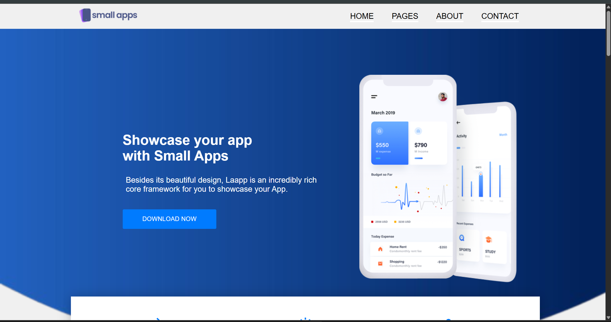
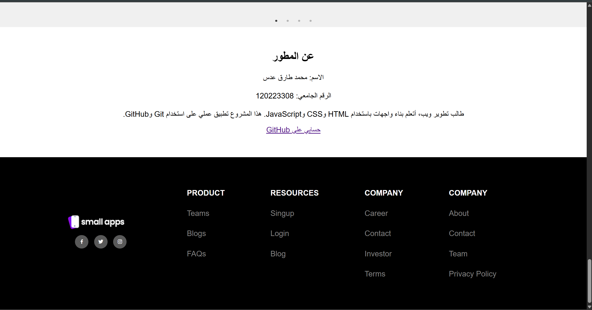

# Simple Web Project

##  وصف المشروع
مشروع تدريبي بسيط باستخدام HTML, CSS, و JavaScript لتعلم أساسيات Git و GitHub وتنظيم المشاريع البرمجية.

##  التقنيات المستخدمة
- HTML
- CSS
- JavaScript
- Git & GitHub

##  خطوات التشغيل
1. نزّل المشروع أو اعمل Clone:
   ```bash
   git clone https://github.com/mohammed-233432/simple-web-project.git
   ```
2. افتح مجلد المشروع.
3. افتح ملف index.html باستخدام المتصفح.
## رابط الموقع
[عرض المشروع](https://mohammed-233432.github.io/simple-web-project/)

## صور المشروع




## المطور 
- محمد طارق عدس 
- 120223308

